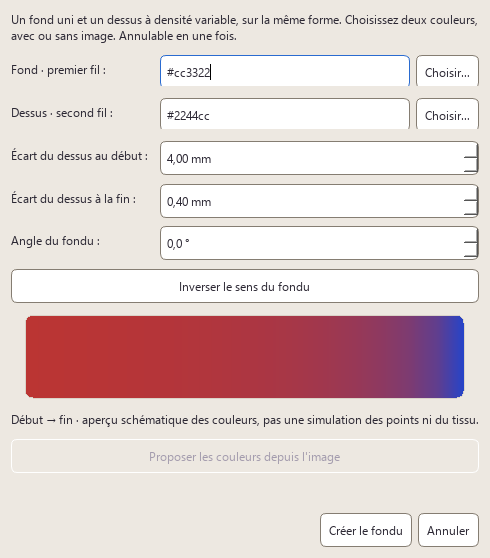
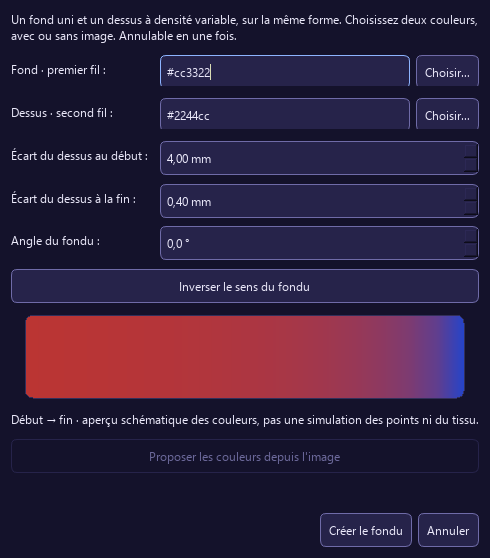

# Fondu de couleurs et vérification des outils UI — 2026-10-13

Base initiale : `54d2828` (PR #36 fusionnée), branche `fix/blend-outils-ui-20261013`.
Avant livraison, `main` intégré jusqu'à `f267afa` (PR #37 et #38), sans conflit.
Ce bilan concerne ce lot, pas les validations du lot UX/UI précédent.

## Fondu livré

- Dialogue commun aux actions Broderie, Forme, barre contextuelle et inspecteur.
- Couleurs manuelles sans image ; proposition raster facultative hors fil UI.
- Angle, écarts début/fin, inversion, aperçu explicitement schématique.
- Aucune mutation avant validation ; une commande composite pour créer/annuler.
- Fond puis dessus contigus dans l'ordre ; choix de couche, couleur et type
  indépendants ; pas de nouvelle persistance `.osp`.

## Défauts reproduits et causes racines

| Défaut | Cause exacte / correction | Preuve |
|---|---|---|
| Fondu absent sans image, mutation sans confirmation, couche inaccessible | Ancien parcours uniquement analytique et mutation directe ; dialogue manuel et sélection explicite | Six repros initiales rouges dans `test_color_blend` |
| Écart initial 3,2 mm affiché 0,4 mm puis écrasé en changeant l'angle | Inspecteur et recalcul lisaient `row_spacing` au lieu de `spacing_from` | `gradientInspectorUsesRealStartSpacing`, `gradientAngleEditPreservesStartSpacing` |
| Conversion du dessus supprimant le fond | `ConvertFillGroupCommand` supprimait tout le même `source_vector`, pas seulement les sections satin | Repros QTest et Catch2 rouges avant correctif ; tests réseau satin conservés |
| Rectangle de sélection devient panoramique après sortie d'édition | Décochage sous `QSignalBlocker` sans resynchroniser `CanvasView::baseContext` | Changement de sélection et remplacement documentaire dans `test_tool_workflows` |
| Changement de mode d'édition annulant le nouveau mode | Slot du mode quitté rappelait `updateActions` avant l'affectation de la nouvelle cible | `secondaryModeSwitchingIsExclusiveAndNonMutating` |
| Déplacement différé d'un ancien nœud modifiant le nouveau document | Timer ne vérifiait pas `documentGeneration_` ; gardes ajoutées aux nœuds et transformations analogues | `deferredHandleReleaseCannotMutateReplacement`, variantes transformations |
| Bouton texte de l'inspecteur inerte | Connexion tentée avant construction de l'inspecteur | Connexion déplacée ; acceptation/annulation et undo/redo testés |
| Désactivation réaliste laissant le pixmap | Timeout appelait `renderStitches` seulement si `enabled` | Repro rouge : un pixmap au lieu de zéro ; correction du timeout |
| Import ajusté perdant cadre et marge | Nouveau `Project{}` effaçait le cadre montré dans le dialogue | Repro rouge 100 × 100 au lieu de 200 × 150 mm ; conservation du cadre |
| Récupération puis édition/undo ne protégeant plus Nouveau | Pile initialement propre malgré récupération non enregistrée | `markDirty`, test de pile et parcours Nouveau/Annuler |
| Hauteur raster indépendante ignorée | Le modèle porte une seule résolution mm/px | Choix anisotrope désactivé et expliqué ; hauteur proportionnelle vérifiée bout en bout |

## Couverture fonctionnelle

`test_tool_workflows.cpp` exerce les **14 valeurs de Tool** : Sélection,
Panoramique, Recadrage, rectangle, ellipse/cercle, polygone, polygone régulier,
Bézier, main levée, colonne satin, guide directionnel, rupture, couteau, texte.
Les gestes viennent du viewport (pas d'injection du signal final) : créer,
sélectionner, modifier, terminer, annuler, changer d'outil, undo/redo. Modes
secondaires : nœuds, points, barreaux/rails satin, guides/ruptures et satin unifié.

`test_ui_action_workflows.cpp` exerce dialogues réaliste et texte, import
ajusté/hauteur/annulation, récupération, Save As/Save relus, simulation,
nuanciers/remplacement, film couleur/sélection/ordre/fusion, analyse/filtrage,
CSV fils relu et exports **DST/PES/JEF/EXP/DXF relus après écriture**.

`test_color_blend.cpp` vérifie 14 scénarios ciblés ; les anciens tests de
`test_main_window` utilisent désormais le dialogue de confirmation.

**Attendus de test corrigés, sans correctif de production artificiel :**
le vide conserve intentionnellement la cible en remodelage satin (la sortie
est testée par un clic sur une autre forme) ; les docks Fils chargent à leur
affichage (les tests les ouvrent) ; le curseur de simulation existe au premier
mouvement ; le layout est stabilisé avant conversion scène → viewport.

## Limites explicites

Ces parcours ne prouvent pas toutes les combinaisons de réglages et de données.
Pas de validation sur machine/tissu, de comparaison de pixels, ni de preuve
du rendu natif Windows à partir des seules captures offscreen. SAM réel, polices
système et réseaux satin complexes ne font pas partie de ces nouveaux tests.
Les erreurs/réécritures des exports et l'import machine multicolore ne sont pas
validés par cette nouvelle suite. L'audit statique a relevé des consommateurs
utilisant la première couleur d'un import machine : à reproduire et traiter
dans un lot dédié, pas présenté ici comme corrigé.

Le fondu reste à deux couleurs et à rampe linéaire ; les paramètres des couches
ne sont pas liés. Le format d'import raster reste proportionnel.

## Validation du lot

Avant intégration des PR #37/#38 de `main` : builds complets et CTest
**Release 1096/1096** et **Debug 1096/1096**, zéro échec. Clang-format **18.1.8**
sur tous les C++ suivis et nouveaux, `git diff --check` : OK. PDF régénéré,
45 chapitres, zéro problème/avertissement.

**Validation finale après intégration de `main` (`f267afa`)** :

| Contrôle exécuté | Résultat |
|---|---|
| Build complet + CTest Release (`-j 4`) | **1105/1105**, zéro échec, 30,41 s |
| Build complet + CTest Debug (`-j 4`) | **1105/1105**, zéro échec, 205,44 s |
| Trois nouvelles suites UI, relancées directement | 14 + 73 + 20 = **107 scénarios ciblés**, zéro échec/skip (hors init/cleanup) |
| Clang-format 18.1.8 sur tous les C++ suivis | OK |
| `git diff --check`, garde `check_no_raw_sequence_bypass` | OK |
| PDF régénéré sur la base intégrée | **264 pages, 45 chapitres, zéro problème/avertissement** |

Les temps sont ceux des suites, pas un banc de performance du moteur.
Linux-core reste à la CI ; aucun code Qt/Windows n'a été ajouté dans les libs.
Journaux locaux : `build/msvc/blend-ui-*-integrated-full.txt` ;
repros : `blend-repro-qtest.txt`, `tools-repro-qtest.txt`,
`actions-repro-qtest.txt`, `conversion-layers-repro.txt`, `import-ratio-repro.txt`.

## Captures de relecture

Captures Qt **offscreen**, polices Segoe UI locales, sans comparaison de pixels :

| Dialogue clair | Dialogue sombre |
|---|---|
|  |  |

[Couches et inspecteur, clair](assets/generated/blend-ui-2026-10-13/blend-layers-light.png)
· [Couches et inspecteur, sombre](assets/generated/blend-ui-2026-10-13/blend-layers-dark.png).
