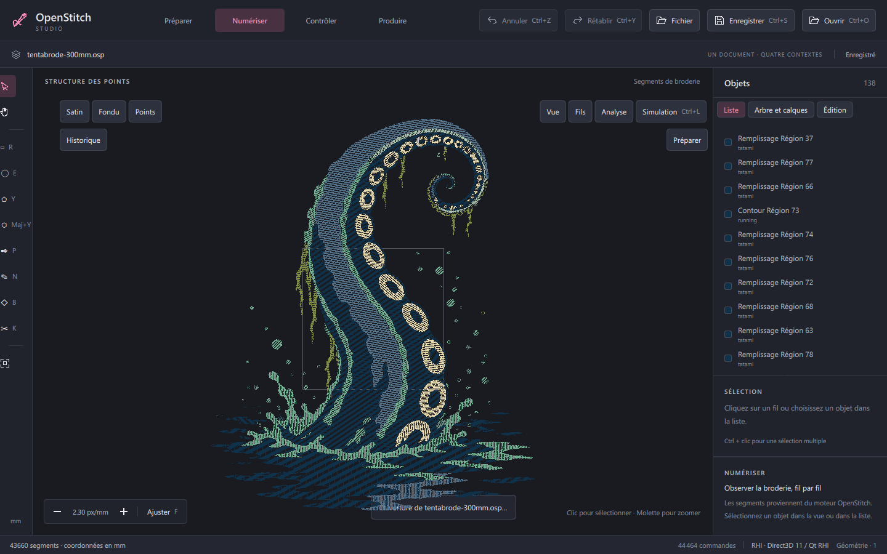

# CX11 — Historique navigable

Le bouton Historique, sous la rangée des outils du canevas, affiche l’état initial,
les commandes passées et celles encore rétablissables. Un clic sur une ligne revient
à cet état en rejouant la pile UndoStack existante. Il n’y a ni second document ni
copie des points dans le contrôleur. La session invalide sa scène une seule fois
après le saut et élague la sélection devenue invalide.

La ligne du dernier enregistrement reste marquée tant qu’elle est atteignable.
Une nouvelle modification après un retour en arrière supprime la branche future
et invalide ce marqueur si nécessaire. Les modifications de paramètres coalescées
restent une seule étape ; un saut nul ou hors limites ne change pas la révision.
La navigation reste propre à la session : l’OSP conserve le résultat courant.

Les tests emploient le vrai shell QML, des clics souris, les commandes du moteur,
la sauvegarde/réouverture OSP et les octets DST à chaque état de l’historique.
Ils contrôlent aussi la divergence, les sélections, la coalescence et la géométrie
du bouton pour éviter le chevauchement avec la barre Vue/Fils/Analyse/Simulation.

Validation avant rebasage : Studio Debug17/17 et Release17/17 ; core299cas/8114assertions
et commandes236cas/1861assertions dans les deux configurations. Apres rebasage sur
c83e423 : Studio Debug **20/20** (91,68s), core Debug **302cas/9838assertions**,
commandes Debug **236cas/1861assertions**. La nouvelle recette Release a ete interrompue
sur demande explicite du proprietaire (« push le tout et arrete toi la »).
Le push est une sauvegarde du travail ; la Release de la base recente reste a verifier.
Format18.1.8 : 1307 fichiers controles, commentaire herite reformate, aucune logique modifiee.
La recette finale du Lead reste distincte : aucune ligne VALIDATED.

Capture réelle Debug après déplacement du bouton, backend affiché `RHI · Direct3D 11 / Qt RHI`,
projet Tentabrode 300 mm (138 objets, 43 660 segments). Le bouton Historique est bien séparé
sur la deuxième rangée, sous Satin/Fondu/Points ; les actions de vue restent accessibles à droite.
La capture ne mesure aucun débit de rendu.

