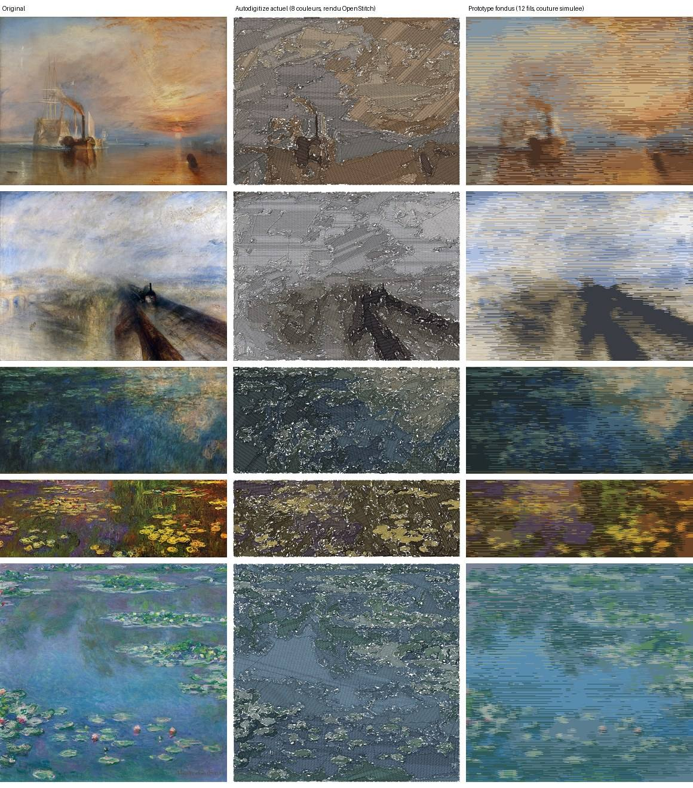

# Fondus picturaux dans l'auto-numérisation : étude (2026-11-17)

Chantier : faire en sorte que l'auto-numérisation reconnaisse seule les **zones
pluricolores** d'une image (dégradés, ciels, eau, brumes : Turner, *Nymphéas* de Monet)
et les couse en **fondus de fils** plutôt qu'en mosaïque d'aplats. Entrée roadmap
**HP-AUTO-017** (détection des zones de dégradé) et prolongement de **HP-STI-010/011**
(fondus multicolores). Ce document rend compte d'un prototype de recherche ; **aucun code
moteur n'est encore modifié**.



*Colonne de gauche : original. Au centre : `openstitch-cli project digitize` actuel
(8 couleurs, `--dpi 160`, rendu réaliste OpenStitch). À droite : prototype, 12 fils,
couture **simulée en couleurs plates** (rangées de 0,4 mm, segments de 3 mm). La colonne de
droite n'est pas un rendu réaliste des fils et ne prouve rien sur la brodabilité.*

## 1. Constat sur l'existant

Mesuré avec le CLI Release de `main` (`beb57380`) sur 5 tableaux du domaine public
(Wikimedia Commons, 960 px de large, 150 mm de broderie) :

| Tableau | Régions segmentées | Objets créés |
|---|---|---|
| Turner, *Le Téméraire* | 449 | 136 |
| Turner, *Pluie, vapeur et vitesse* | 512 | 121 |
| Monet, *Reflets de nuages* | 1 165 | 281 |
| Monet, *Nymphéas* (Orangerie) | 1 208 | 306 |
| Monet, *Nymphéas* 1906 (Chicago) | 2 369 | 543 |

Trois défauts, visibles sur la planche :

1. **Postérisation** : la quantification globale (8 couleurs) découpe chaque dégradé en
   bandes à bord net, puis en centaines d'îlots.
2. **Perte des teintes rares** : le soleil et l'orange du *Téméraire* disparaissent,
   absorbés par des gris-beiges majoritaires.
3. **Tissu visible** entre les îlots (points blancs sur le rendu).

Le moteur sait pourtant déjà coudre des fondus de 2 à 8 fils sur **grille partagée**
(`DensityGradient::shared_rows`, cf. `docs/source/directional-fill.md`) : chaque rangée est
cousue par exactement un fil, choisi parce que son seuil de Weyl tombe dans la tranche
`[lower ; lower + w)` de ce fil. Mais les poids `w` ne dépendent que d'un **paramètre
géométrique** `t` (axe, rayon, spirale, distance au bord). Ils ne viennent jamais de l'image,
et l'auto-numérisation ne crée aucun fondu.

## 2. Prototype

`scripts/fondus_picturaux_proto.py` (Python, numpy/scikit-image/scipy, déterministe : aucun
générateur aléatoire, k-means initialisé par quantiles).

```
python scripts/fondus_picturaux_proto.py image.jpg sortie/ 150 2.5   # largeur mm, seuil de bord
# variables : PALETTE=12 (fils au total), KMAX=4 (fils par zone), LAM=0.05 (localité)
```

Chaîne :

1. **Image de travail** à 0,5 mm/px, lissage gaussien de 1,5 px : les couleurs « vues de
   loin », le fil ne rendra pas le grain de la toile.
2. **Zones** : gradient de Sobel en Lab (ΔE par pixel), sur-segmentation par ligne de
   partage des eaux sur ce gradient, puis **fusion hiérarchique selon la force du bord commun**
   (et non selon l'écart des couleurs moyennes) : un dégradé lent se fond en une seule zone,
   un bord net l'arrête. Les zones de moins de 25 mm² sont absorbées par leur voisine.
3. **Palette globale de mélange** (N fils pour tout le motif) : 48 candidats k-means plus les
   extrêmes (1er et 99e centiles sur les 3 axes principaux), puis sélection gloutonne qui
   minimise l'erreur de **mélange**, pas de quantification. Un mélange ne sort jamais de
   l'enveloppe convexe de ses fils : une palette k-means classique éteint les teintes
   saturées.
4. **Par zone** : choix glouton de ≤ K fils de la palette (on n'ajoute un fil que s'il réduit
   l'erreur d'au moins 20 %), puis **poids par pixel** par moindres carrés non négatifs, de
   somme 1, en RVB linéaire (le mélange optique de fils voisins est additif en lumière).
   Le terme de localité `λ·Σ wᵢ‖cᵢ − v‖²` favorise les fils proches de la couleur visée.
5. **Couture simulée** : rangées horizontales de 0,4 mm, seuil de Weyl du nombre d'or par
   rangée, segments de 3 mm décalés en brique ; chaque segment prend le fil dont la tranche
   cumulée contient le seuil, évaluée en son milieu, exactement la règle de
   `SpacingField::owns`. Vue à distance : flou gaussien de 1 mm.

## 3. Mesures

ΔE76 (Lab) contre l'image lissée, 12 fils au total, ≤ 4 fils par zone, seuil de bord 2,5,
λ = 0,05. Référence : quantification k-means à 12 couleurs **pixel par pixel**. Elle est
avantagée, car elle suppose qu'on sait coudre des milliers d'îlots d'un pixel.

| Tableau | Zones | Couches | Quantif. 12 (moy. / p90) | Mélange idéal | **Couture simulée, vue à 1 mm** |
|---|---|---|---|---|---|
| *Le Téméraire* | 27 | 98 | 5,68 / 10,6 | 3,27 | **4,11 / 7,3** |
| *Pluie, vapeur…* | 42 | 134 | 5,76 / 11,5 | 3,27 | **4,31 / 9,4** |
| *Reflets de nuages* | 65 | 226 | 5,34 / 9,3 | 3,56 | **4,26 / 7,5** |
| *Nymphéas* Orangerie | 69 | 244 | 8,01 / 13,2 | 5,46 | 7,61 / 13,5 |
| *Nymphéas* 1906 | 68 | 236 | 5,68 / 9,9 | 5,32 | 6,41 / 12,3 |

Enseignements :

- **Les ciels, l'eau et la brume sont gagnés** (Turner, *Reflets*) : 20 à 28 % d'erreur en
  moins avec 27 à 65 zones au lieu de 450 à 1 200 régions, et sans aucun bord artificiel.
- **Le petit détail à bord net est perdu** (nénuphars, fleurs, mâts) : l'écart entre
  « mélange idéal » et « couture simulée » (≈ 1 ΔE) est la limite de résolution d'une
  rangée de 0,4 mm × 3 mm. Sur le Monet de 1906, le fondu seul perd. Il faut donc un
  **modèle hybride** : le fondu en fond, puis les détails cousus par-dessus en objets
  ordinaires (§4, lot 3).
- **Le mélange est 2D, pas 1D** : sur *Le Téméraire*, 62 % des pixels mélangent 3 fils ou
  plus (51 % trois, 11 % quatre, poids > 5 %). Un fondu le long d'un axe ou
  d'un rayon (un seul paramètre `t`, deux fils voisins à la fois) ne suffit pas.
- **λ** : 0,5 (mélanges très locaux) coûte 1 à 2 ΔE ; 0,05 est meilleur partout à distance,
  au prix de contrastes plus marqués entre rangées vues de près. À trancher sur pièce-test.
- Palette : 12 fils suffisent pour les Turner ; l'Orangerie (51 mm de haut, très chargée)
  reste au-dessus de ΔE 7 : le budget de fils devra être un réglage.

Limites : modèle optique de mélange linéaire (ni brillance ni ombre du fil), rangées toutes
horizontales, couleurs non rapprochées d'un nuancier réel, aucune broderie physique.

## 4. Proposition d'architecture

Principe : **la détection et les poids viennent de l'image ; la couture reste celle,
déjà validée, de la grille partagée**. Tout est déterministe (aucune graine, ordre fixé) et
les points ne sont jamais stockés : l'objet porte un champ de poids, la génération en déduit
les rangées.

### Lot 1 : champ de poids image dans le fondu multicolore (moteur)

- `MulticolorGradientParams` gagne un champ facultatif `weight_field` : grille régulière
  (origine et pas en µm, pas conseillé 1 mm), `palette.size()` poids `uint8` par case, de
  somme normalisée. Absent = comportement actuel octet pour octet.
- `SpacingField::band(p)` pour la couche `i` : interpolation bilinéaire des poids,
  `lower = Σ_{j<i} w_j`, `weight = w_i`. `owns` est inchangé : la couverture exacte de la
  grille partagée est conservée, quelles que soient les proportions.
- Sérialisation `.osp` (base64 compact), `inspect`/`set_params`, test de couverture
  (« un champ de poids couvre la forme comme un remplissage uni ») et test de déterminisme.
- Taille : une zone de 100 × 100 mm à 1 mm de pas et 4 fils occupe 40 Ko.

### Lot 2 : détection des zones et palette de mélange (`libs/autodigitize`)

- `autodigitize::detect_blend_zones` : portage C++ des étapes 1, 2 et 4 du prototype
  (OpenCV derrière l'interface `image`/`segmentation`, comme aujourd'hui), avec un NNLS
  maison sur ≤ 4 inconnues (pas de dépendance nouvelle).
- Palette de mélange globale, puis rapprochement vers le nuancier actif
  (`thread_palette`, comme `best_thread_pair`).
- Option `--blend-zones` (désactivée par défaut) dans `digitize` / `project digitize`, case
  à cocher du dialogue d'auto-numérisation de Studio, rapport JSON : zones, fils par zone,
  ΔE estimé.
- Ordre de couture : les couches complémentaires ne se chevauchent pas, on peut donc coudre
  **fil par fil sur toutes les zones** (N changements de couleur au lieu de Σ couches).
  À vérifier avec le séquenceur.

### Lot 3 : hybride fond fondu + détails

- Les régions petites et à bord net (contraste ΔE de bord élevé, aire < seuil :
  nénuphars, fleurs, mâts) restent des objets ordinaires (tatami, satin, contour), cousus
  **après** le fond. Le fond est cousu sous eux (pas de découpe), comme un digitaliseur
  humain.
- Critère d'acceptation : sur le Monet de 1906, couture simulée sous la quantification à
  12.

### Lot 4 : direction des rangées

- Angle des rangées par zone selon le **tenseur de structure** de l'image (sens des coups
  de pinceau : ciel tourbillonnant de Turner, reflets horizontaux de Monet), et passage en
  remplissage directionnel à guides si l'orientation varie dans la zone.

### Place de l'IA

Le cœur reste déterministe et mesurable. L'IA intervient en option, sans jamais produire de
points :

- **Réglages** : un modèle (local via Ollama, ou Claude par le MCP OpenStitch) choisit le seuil
  de bord, le budget de fils et λ à partir des métriques ci-dessus, en balayage
  (`project sweep`), comme un opérateur.
- **Sémantique** (*ciel*, *eau*, *nénuphar*) : elle oriente la classification du lot 3 et
  la direction du lot 4, via les annotations `SemanticAnnotation` existantes.
- **Modèle appris** (IA-DATA-01) : un classifieur « zone de fondu / aplat / détail » pourra
  remplacer le seuil fixe une fois que le corpus de mesures le justifie, jamais sans mesure
  comparative.

## 5. Ce qui reste à prouver

- Une couture réelle : densité, tirage, brillance et visibilité des rangées contrastées
  (λ faible) ne se voient que sur pièce-test.
- Le rendu réaliste OpenStitch du fondu par champ (dès le lot 1), à comparer à la
  simulation plate.
- Le temps de calcul en C++ (le prototype Python prend 7 à 20 s par image).
