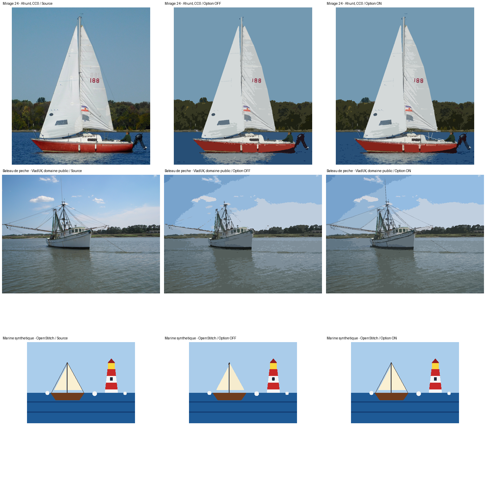

# SEG-FINE-01 — Essais sur des bateaux

Comparaison sur le moteur `6d535b9d` avec `segment_image`, 8 couleurs, taille minimale de 16 px
et rayon de lissage de 1 px. Seule l'option `fine_structures` change entre OFF et ON. Les deux
photos sont ramenées à 960 px sur le côté long avec Lanczos. La fixture conserve sa taille native.
Trois exécutions alternées par réglage produisent les mêmes labels pour chaque image et réglage.
Le temps médian couvre le lancement du CLI, la segmentation et l'écriture OSP.

| Image | Régions OFF → ON | Temps OFF → ON | Observation |
| --- | ---: | ---: | --- |
| Mirage 24 | 717 → 2 137 | 0,44 → 1,75 s | Peu de gain visible sur le gréement. Davantage de marques dans l'eau. |
| Bateau de pêche | 1 200 → 3 012 | 0,52 → 1,75 s | Câbles et antenne plus visibles. Eau et arrière-plan davantage fragmentés. |
| Marine synthétique | 20 → 22 | 0,12 → 0,21 s | Le rendu ON restitue exactement la couleur source des 179 pixels du masque de gréement. |

Dans la marine synthétique, le rendu des régions ON restitue aussi la couleur source sur les
masques annotés du ciel et de l'eau. Sur les deux photos, les observations restent qualitatives.
Les comptes de régions ne mesurent pas le taux de faux traits.

- Mirage 24 par Ahunt, CC0. [Image source](https://commons.wikimedia.org/wiki/File:Mirage_24_sailboat_Reflection_3878.jpg)
- Bateau de pêche par VladUK, domaine public. [Image source](https://commons.wikimedia.org/wiki/File:Fishing_Boat.JPG)
- Marine synthétique et masques de référence. [Fixture du dépôt](../../tests/fixtures/ai-benchmark/marine-synth-01)
